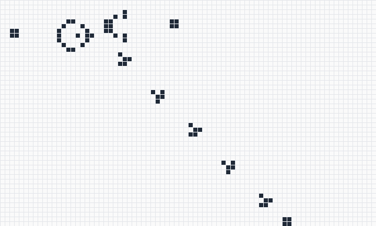
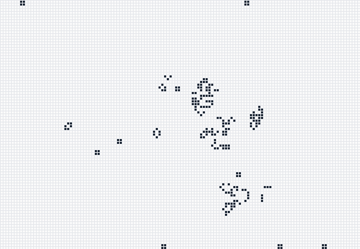

# Jeu de la Vie 🧬

[](https://github.com/Alflash10/jeu-de-la-vie/actions/workflows/tests.yml)


Simulateur complet du **Jeu de la Vie de John Conway** et de ses variantes, en
Python pur : interface graphique Tkinter, ligne de commande, règles
personnalisables, import/export au format standard **RLE**, export **PNG** et
détection automatique des motifs stables, des oscillateurs et des vaisseaux.

Aucune dépendance externe : uniquement la bibliothèque standard.



*Le canon à planeurs de Gosper après 240 générations : il tire un planeur toutes les 30 générations.
Image produite par `jeu-de-la-vie simuler gosper -n 240 --taille 48x80 --coin --png …`.*

## Sommaire

- [Règles](#règles)
- [Installation](#installation)
- [Interface graphique](#interface-graphique)
- [Ligne de commande](#ligne-de-commande)
- [Architecture et choix techniques](#architecture-et-choix-techniques)
- [Tests et intégration continue](#tests-et-intégration-continue)

## Règles

Chaque cellule a 8 voisines. À chaque génération, dans le Jeu de la Vie
classique (règle **B3/S23**) :

| Situation | Voisines vivantes | Résultat |
|---|---|---|
| Cellule morte | exactement 3 | naît |
| Cellule vivante | 2 ou 3 | survit |
| Cellule vivante | moins de 2 ou plus de 3 | meurt |

La notation **B/S** (*Birth / Survival*) décrit toute une famille d'automates.
Le programme en accepte n'importe laquelle (sauf B0) et en propose plusieurs :

| Règle | Nom | Particularité |
|---|---|---|
| B3/S23 | Conway | le Jeu de la Vie classique |
| B36/S23 | HighLife | contient un motif qui se recopie lui-même |
| B2/S | Seeds | aucune cellule ne survit, croissance explosive |
| B3678/S34678 | Day & Night | symétrique : les zones mortes et vivantes se comportent pareil |
| B3/S012345678 | Vie sans mort | une cellule née ne meurt jamais |
| B3/S12345 | Labyrinthe | dessine des couloirs |
| B368/S245 | Morley | riche en vaisseaux |
| B1357/S1357 | Replicator | chaque motif finit recopié à l'identique |

## Installation

Python 3.9 ou plus récent, avec Tkinter pour l'interface graphique.

```bash
git clone https://github.com/Alflash10/jeu-de-la-vie.git
cd jeu-de-la-vie
python3 -m jeu_de_la_vie          # lance directement, sans installation
```

Ou en l'installant, ce qui ajoute la commande `jeu-de-la-vie` :

```bash
pip install .
jeu-de-la-vie
```

Tkinter est fourni avec Python sous Windows et avec l'installateur de python.org.
Avec le Python de Homebrew sur macOS : `brew install python-tk`.
Sous Debian/Ubuntu : `sudo apt install python3-tk`.

## Interface graphique

| | |
|---|---|
| **Simulation** | lecture/pause, génération suivante et **précédente** (historique de 1000 états), vitesse de 1 à 60 générations par seconde |
| **Dessin** | clic pour allumer ou éteindre une cellule, clic maintenu pour dessiner ou gommer ; la barre d'état indique la position et le nombre de voisines de la cellule survolée |
| **Motifs** | 17 motifs classiques, rangés par catégorie : stables, oscillateurs, vaisseaux, mathusalems, canons, autres règles |
| **Analyse** | génération, population, **courbe de population**, et détection en direct : « Oscillateur de période 15 », « Vaisseau de période 4, se déplace de (+1, +1) »… La lecture s'arrête seule quand tout est figé |
| **Univers** | règle au choix (liste ou saisie libre en notation B/S), grille de 30×30 à 150×150, bords reliés (tore) ou fermés, naissances colorées en bleu |
| **Fichiers** | ouverture et enregistrement de motifs **RLE**, copier-coller RLE (pour reprendre un motif depuis [LifeWiki](https://conwaylife.com/wiki/) en un clic), export **PNG** |

La grille s'agrandit toute seule si un motif chargé ne tient pas dedans, et le
motif courant reste centré quand on change la taille.

### Raccourcis clavier

| Touche | Action |
|---|---|
| `Espace` | lecture / pause |
| `→` ou `N` | génération suivante |
| `←` ou `Ctrl+Z` (`⌘Z`) | annuler / génération précédente |
| `+` / `-` | plus vite / moins vite |
| `R` | remplissage aléatoire |
| `C` | effacer la grille |
| `Ctrl+O` / `Ctrl+S` | ouvrir / enregistrer un motif RLE |
| `Ctrl+C` / `Ctrl+V` | copier / coller un motif RLE |
| `Ctrl+E` | exporter en PNG |

Sur macOS, `Ctrl` est remplacé par `⌘`.

## Ligne de commande

La simulation peut aussi tourner sans fenêtre :

```console
$ jeu-de-la-vie simuler planeur -n 8 --afficher
Motif      : Planeur
Univers    : 23×23, bords fermés, règle Conway (B3/S23)
Population : 5 → 5 cellules en 8 générations
Évolution  : Vaisseau de période 4, se déplace de (+1, +1)

·█·
··█
███
```

```bash
jeu-de-la-vie motifs                                    # liste des motifs intégrés
jeu-de-la-vie regles                                    # liste des règles connues
jeu-de-la-vie simuler pulsar --jusqu-au-cycle           # s'arrête dès qu'un état se répète
jeu-de-la-vie simuler exemples/canon-gosper.rle -n 300 --taille 60x100 --png canon.png
jeu-de-la-vie simuler --aleatoire 0.3 --graine 42 --taille 80 --regle B36/S23 -n 500 --rle resultat.rle
```

Options de `simuler` : `-n` (générations), `--taille 80` ou `60x100`,
`--regle`, `--tore`, `--coin` (motif en haut à gauche au lieu d'être centré),
`--aleatoire DENSITE` et `--graine`, `--jusqu-au-cycle`, `--afficher`, `--png`
avec `--cote` (taille des cellules en pixels), et `--rle`.
`jeu-de-la-vie simuler --help` les détaille.



*Le R-pentomino, 5 cellules au départ, après 600 générations. Il ne se stabilise qu'à la génération 1103.*

## Architecture et choix techniques

```
jeu_de_la_vie/
├── moteur.py      simulation, historique, détection des cycles (aucune dépendance à l'interface)
├── regles.py      notation B/S et règles connues
├── motifs.py      bibliothèque de motifs, dessinés en texte (O = vivante, . = morte)
├── rle.py         lecture et écriture du format RLE
├── image.py       export PNG écrit à la main (zlib + struct)
├── cli.py         ligne de commande (argparse)
└── interface.py   interface Tkinter
tests/             tests unitaires, y compris de l'interface
exemples/          motifs au format RLE
```

**Grille creuse.** Le moteur ne stocke que l'ensemble des cellules vivantes.
Une génération compte les voisines de ces cellules uniquement, avec un
`collections.Counter`. Son coût dépend donc du nombre de cellules vivantes et
pas de la taille de la grille.

**Affichage incrémental.** Chaque cellule est un rectangle du canevas, créé une
seule fois. À chaque génération, le moteur renvoie l'ensemble des cellules qui
ont changé d'état et seules celles-ci sont recolorées. Sans cela, il faudrait
recolorer les 22 500 rectangles d'une grille 150×150 à chaque génération, même
quand seules quelques cellules bougent, comme avec un canon ou des vaisseaux.

**Détection des cycles.** À chaque génération, le moteur enregistre une
empreinte (hash) de l'état. Si elle revient, l'état s'est répété : l'écart
donne la période (1 pour un motif stable). Une seconde empreinte, calculée sur
la forme ramenée dans le coin de sa boîte englobante, reconnaît un motif
identique mais déplacé : c'est un vaisseau, dont on obtient la vitesse.
Seuls des entiers sont conservés, pas les états eux-mêmes, donc la mémoire
reste faible.

**Format RLE.** C'est le format de Golly et de LifeWiki. Les motifs créés ici
s'ouvrent donc dans les autres logiciels, et inversement. La règle est
enregistrée avec le motif : ouvrir un motif HighLife bascule automatiquement
sur la bonne règle.

**PNG sans bibliothèque.** Un PNG est une signature suivie de blocs
`IHDR` (dimensions), `IDAT` (pixels compressés avec zlib) et `IEND`, chacun
suivi d'un CRC32. `zlib` et `struct` suffisent à l'écrire. Les tests relisent
l'image produite pour vérifier les CRC et la couleur des pixels.

## Tests et intégration continue

```bash
python3 -m unittest discover -s tests -t . -v
```

75 tests couvrent :

- **les règles** : naissance, survie, surpopulation, bords toriques, règles
  autres que Conway ;
- **des motifs connus** comme référence : un bloc est stable ; le clignotant,
  le pulsar, la galaxie de Kok et le pentadécathlon ont les périodes 2, 3, 8
  et 15 ; le planeur se décale d'une case en diagonale toutes les 4
  générations ; le canon de Gosper tire un planeur toutes les 30 générations ;
  le diehard disparaît exactement à la génération 130 ; le réplicateur
  HighLife se recopie en 12 générations ;
- **l'historique** et la **détection des cycles** ;
- **les formats** : allers-retours RLE sur tous les motifs, et décodage du
  PNG produit ;
- **la ligne de commande** ;
- **l'interface** : les tests pilotent la vraie fenêtre Tkinter (dessin à la
  souris, annulation, copier-coller, changement de règle et de taille).

À chaque push, GitHub Actions vérifie le code avec
[Ruff](https://docs.astral.sh/ruff/) et lance tous les tests sous Python 3.10
et 3.13. Les tests de l'interface tournent dans un écran virtuel (Xvfb).
L'intégration continue installe aussi le paquet et essaie la commande
`jeu-de-la-vie`.

## Auteurs

- Alexandre Bourgine
- Leul (partenaire de projet)

Commencé comme projet de lycée en spécialité NSI (Numérique et Sciences
Informatiques), puis repris et étendu.
